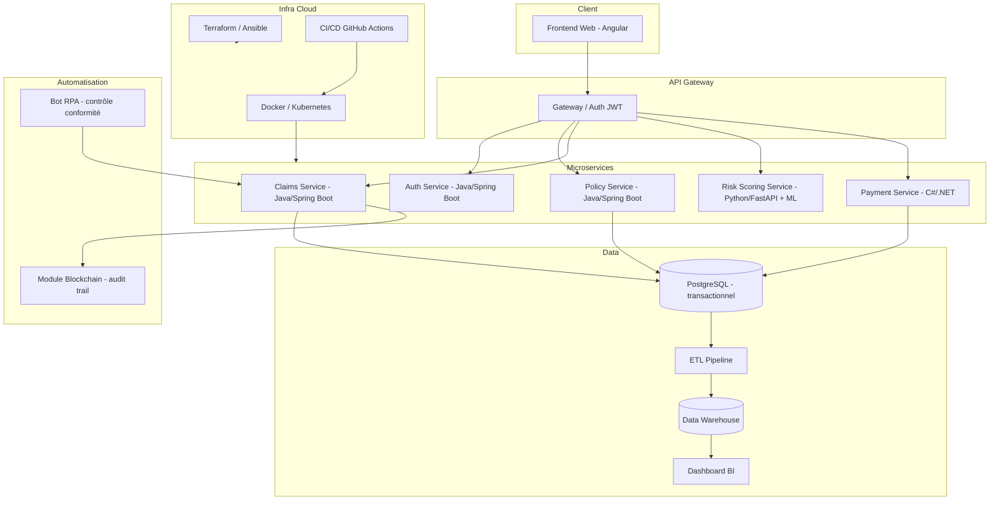

# AssurCore — Plateforme de Gestion des Risques, Sinistres & Paiements

## Projet fil rouge — Programme Expert Bac+5 EADL (RNCP 39765)

---

## 1. Pitch du projet

**AssurCore** est une plateforme SaaS destinée à un assureur fictif (multi-branches : auto, habitation, santé). Elle permet de :
- Souscrire des contrats et gérer des polices d'assurance
- Déclarer et instruire des sinistres
- Scorer le risque client via un moteur data/ML
- Déclencher des paiements/indemnisations
- Fournir un tableau de bord décisionnel (BI) à la direction
- Automatiser les tâches répétitives (contrôle de conformité, relances) via RPA
- Garantir traçabilité et sécurité des données sensibles (audit blockchain)

Ce projet est volontairement complet pour que **chaque brique corresponde à un bloc de compétences** du référentiel RNCP, avec des livrables mobilisables tels quels dans ton dossier de certification.

---

## 2. Mapping Compétences RNCP → Livrables du projet

| Bloc RNCP | Compétences clés | Livrable concret dans AssurCore |
|---|---|---|
| **Bloc 1 — Architecture logicielle** | Concevoir l'architecture, choisir les technos, UML, TDD | Diagrammes UML (cas d'usage, classes, séquence, déploiement), ADR (Architecture Decision Records), suite de tests TDD sur le service Risk-Scoring |
| **Bloc 2 — Dev, intégration, déploiement continu** | CI/CD, tests auto, DevSecOps, Clean Code, doc technique | Pipeline GitHub Actions, SonarQube/Clean Code, scan de sécurité (DevSecOps), documentation technique (README, ADR, Swagger) |
| **Bloc 3 — Cloud Computing** | API cloud, Terraform/Ansible, sécurité cloud, blockchain | Infra as Code (Terraform), conteneurisation (Docker/K8s), déploiement cloud (AWS/Azure), module blockchain d'audit des sinistres |
| **Bloc 4 — Architectures de données & automatisation** | ETL, Big Data, BI, RPA | Pipeline ETL (contrats → data warehouse), dashboard BI (Metabase/Power BI), bot RPA (contrôle conformité dossiers) |
| **Bloc 5 — Gestion de projet numérique** | Cahier des charges, planning, Agile, suivi, veille | Cahier des charges (ce document), backlog produit, sprints Scrum, comptes-rendus, veille techno |

---

## 3. Architecture cible (vue macro)

---

## 4. Stack technique (couvre les 3 langages exigés + cloud)

| Composant | Techno | Justification |
|---|---|---|
| Service Auth | **Java / Spring Boot** | Standard entreprise, sécurité robuste (Spring Security) |
| Service Policy (contrats) | **Java / Spring Boot** | Cohérence avec l'écosystème Java |
| Service Claims (sinistres) | **Java / Spring Boot** | Idem + intégration blockchain |
| Service Risk-Scoring | **Python / FastAPI + scikit-learn** | Écosystème data/ML le plus riche |
| Service Payment | **C# / .NET** | Démontre la polyvalence multi-langage exigée |
| Frontend | Angular + TypeScript | Framework structuré, standard en entreprise (voir ADR-006) |
| Base transactionnelle | PostgreSQL | Fiabilité ACID pour données financières |
| Data Warehouse / BI | DuckDB ou PostgreSQL analytique + Metabase | Léger, facile à démontrer |
| IaC | Terraform + Ansible | Exigé explicitement par le référentiel |
| Conteneurisation | Docker + docker-compose (K8s en option avancée) | Déploiement reproductible |
| CI/CD | GitHub Actions | Gratuit, largement utilisé en entreprise |
| Sécurité DevSecOps | Trivy (scan images), OWASP Dependency-Check | Intégré au pipeline |
| RPA | Python (script d'automatisation façon RPA) | Simule UiPath sans licence |
| Blockchain | Smart contract simple (Solidity/Hardhat local ou hashing chainé) | Preuve de traçabilité des sinistres |

---

## 5. Roadmap en 7 phases (méthode Agile/Scrum, sprints de ~1-2 semaines)

| Phase | Contenu | Livrables |
|---|---|---|
| **Phase 0 — Cadrage** ✅ | Cahier des charges, choix techno, backlog | Ce document + backlog produit |
| **Phase 1 — Architecture & modélisation** | UML (cas d'usage, classes, séquence), ADR, maquettes | Diagrammes + ADR |
| **Phase 2 — Cœur applicatif (TDD)** | Service Policy + Claims en TDD, Clean Code | Code + tests unitaires (couverture >80%) |
| **Phase 3 — CI/CD & DevSecOps** | Pipeline GitHub Actions, scans sécurité, doc technique | `.github/workflows`, rapport Trivy/OWASP |
| **Phase 4 — Cloud & IaC** | Terraform, Ansible, déploiement Docker/K8s | Scripts IaC + déploiement fonctionnel |
| **Phase 5 — Data, BI & RPA** | ETL, entrepôt de données, dashboard, bot RPA | Pipeline ETL + dashboard + bot |
| **Phase 6 — Sécurité avancée & Blockchain** | Module blockchain d'audit, durcissement sécurité | Smart contract / chaîne de hash |
| **Phase 7 — Dossier RNCP** | Rédaction du dossier de certification, préparation soutenance | Dossier + support de soutenance |

---

## 6. Prochaine étape immédiate

On démarre la **Phase 1** : je vais produire les diagrammes UML (cas d'usage + classes + séquence pour "déclarer un sinistre") et les premiers ADR (Architecture Decision Records) qui justifient les choix ci-dessus — c'est ce qu'un jury RNCP attend en premier lieu.

Dis-moi si tu valides ce cadrage (nom du projet, stack, roadmap) ou si tu veux ajuster quelque chose avant qu'on attaque le concret.
