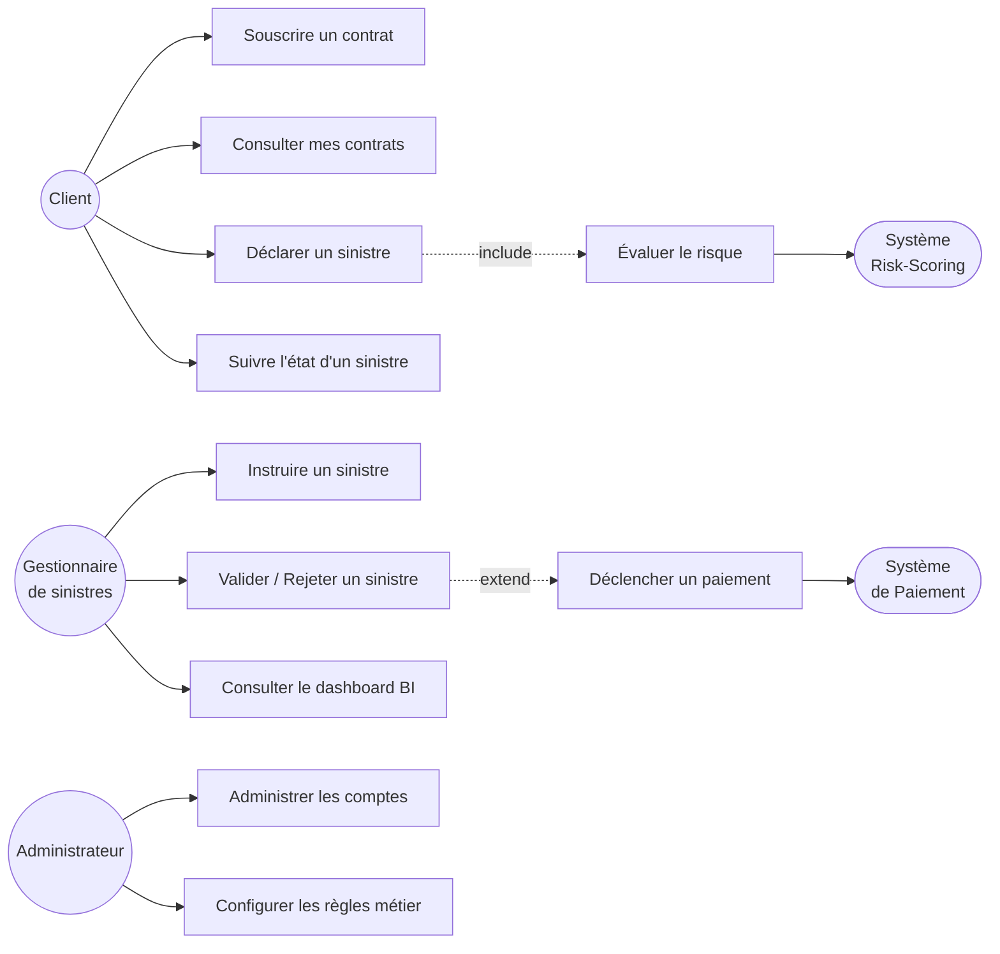

# Diagramme de cas d'utilisation (Use Case Diagram)

## À quoi ça sert ?

Le diagramme de cas d'utilisation répond à UNE question : **"Qui peut faire quoi avec le système ?"**
C'est le tout premier diagramme UML à produire, car il sert de contrat entre toi (l'architecte) et les
"métiers" (ici : direction assurance, gestionnaires de sinistres, clients). Il ne décrit **ni la technique,
ni les données** — uniquement les interactions fonctionnelles.

## Vocabulaire UML utilisé

- **Acteur** (bonhomme) : une entité externe qui interagit avec le système (humain ou autre système).
- **Cas d'utilisation** (ellipse) : une action/fonctionnalité que le système rend possible.
- **Association** (trait plein) : un acteur utilise un cas d'utilisation.
- **Include** (flèche pointillée `<<include>>`) : un cas d'utilisation en appelle systématiquement un autre.
- **Extend** (flèche pointillée `<<extend>>`) : un cas d'utilisation en complète un autre, mais de façon optionnelle/conditionnelle.

## Le diagramme

## Lecture / justification métier

- **Client** : acteur principal en libre-service (souscription, déclaration, suivi). Aucune action de
  validation ne lui est ouverte — séparation stricte entre déclaration et instruction (principe de
  contrôle interne classique en assurance).
- **Gestionnaire de sinistres** : acteur métier qui instruit et arbitre. `Valider/Rejeter un sinistre`
  peut déclencher (`extend`, donc optionnel/conditionnel) `Déclencher un paiement` — un rejet ne paie pas.
- **Système Risk-Scoring** et **Système de Paiement** sont modélisés comme des **acteurs systèmes** (pas
  humains) car ce sont d'autres microservices consommés — cela anticipe directement l'architecture
  microservices (voir ADR-001).
- `Déclarer un sinistre` **include** systématiquement `Évaluer le risque` : chaque sinistre déclaré passe
  obligatoirement par le scoring automatique, contrairement au paiement qui reste conditionnel.

## Ce que ce diagramme NE dit PAS (et pourquoi c'est normal)

Il ne montre ni les entités métier (Contrat, Sinistre...), ni l'enchaînement temporel des actions.
C'est volontaire : ces deux aspects sont couverts respectivement par le **diagramme de classes**
et le **diagramme de séquence** (fichiers suivants). Mélanger les préoccupations dans un seul diagramme
est une erreur fréquente de débutant — chaque diagramme UML a une responsabilité unique.
