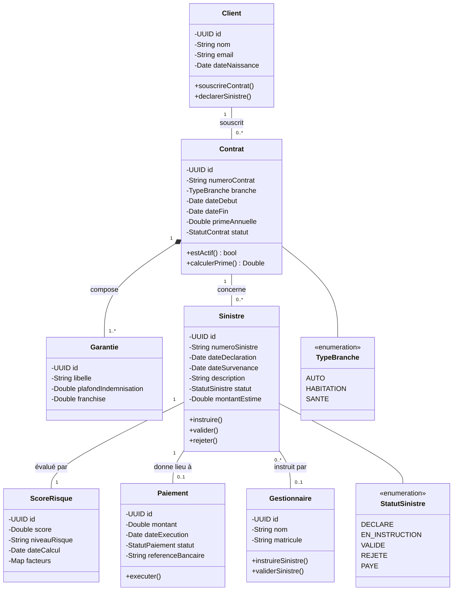

# Diagramme de classes (Class Diagram)

## À quoi ça sert ?

Le diagramme de classes répond à la question : **"Quelles sont les entités métier du système, leurs
attributs, et comment sont-elles reliées entre elles ?"** C'est le diagramme structurel le plus utilisé
en entreprise, car il sert directement de base au modèle de données et au code objet (entités JPA côté
Java, modèles Pydantic côté Python, etc.).

## Vocabulaire UML utilisé

- **Classe** : rectangle en 3 parties (nom / attributs / méthodes).
- **Association** (trait plein) : deux classes sont liées ; les cardinalités (`1`, `0..1`, `1..*`, `*`)
  précisent combien d'instances sont concernées de chaque côté.
- **Agrégation** (losange vide) : relation "contient" faible — les parties peuvent exister sans le tout.
- **Composition** (losange plein) : relation "contient" forte — la partie ne peut pas exister sans le tout
  (si on supprime le tout, les parties sont supprimées aussi).
- **Héritage** (flèche triangle vide) : une classe fille hérite d'une classe mère.

## Le diagramme

## Lecture / justification des choix de modélisation

- **Composition** entre `Contrat` et `Garantie` (losange plein) : une garantie n'a pas de sens sans le
  contrat qui la porte. Si le contrat est supprimé, ses garanties le sont aussi.
- **Association simple** entre `Client` et `Contrat` (pas de composition) : un contrat peut légalement
  continuer d'exister même si l'enregistrement client est archivé (obligation réglementaire de
  conservation en assurance).
- **`ScoreRisque` est une classe à part entière et non un simple attribut de `Sinistre`** : cela permet
  de conserver l'historique des scores (traçabilité, ré-évaluation), et surtout cela reflète la
  séparation technique réelle : `ScoreRisque` est produit par un microservice différent
  (`risk-scoring-service`, en Python) de celui qui gère `Sinistre` (`claims-service`, en Java).
  **Le diagramme de classes logique anticipe ici directement la frontière entre microservices.**
- **`Paiement` est `0..1` par rapport à `Sinistre`** (cardinalité optionnelle) : cohérent avec le
  use case `Déclencher un paiement` marqué `<<extend>>` — tous les sinistres ne donnent pas lieu à
  paiement.
- Les **enums** (`TypeBranche`, `StatutSinistre`) évitent les chaînes de caractères libres en base —
  bonne pratique Clean Code qui sera appliquée dans le code réel en Phase 2.

## Lien avec le code (Phase 2)

Chaque classe ci-dessus deviendra une entité JPA (`@Entity`) dans `policy-service` et `claims-service`,
ou un modèle Pydantic dans `risk-scoring-service`. Le diagramme sert donc de spécification directe
avant d'écrire la moindre ligne de code — c'est l'esprit de la conception dirigée par le modèle.
