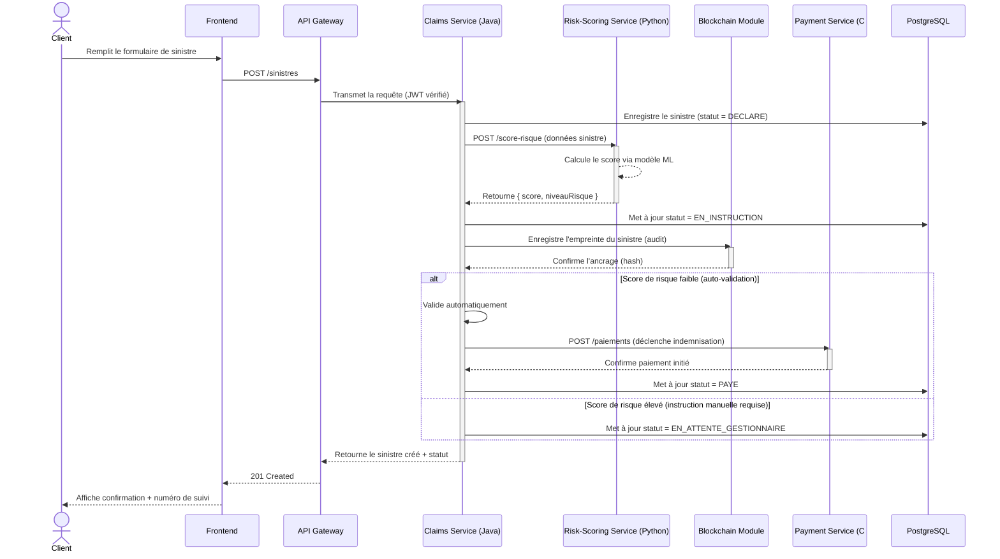

# Diagramme de séquence — "Déclarer un sinistre"

## À quoi ça sert ?

Le diagramme de séquence répond à la question : **"Dans quel ordre exact les composants du système
s'échangent-ils des messages pour réaliser un scénario précis ?"** Contrairement au diagramme de cas
d'utilisation (vue globale) ou au diagramme de classes (vue statique), le diagramme de séquence est
une vue **dynamique et temporelle** : le temps s'écoule du haut vers le bas.

C'est le diagramme le plus utile pour valider qu'une architecture microservices "tient la route" avant
d'écrire le code, car il oblige à décider concrètement quel service appelle quel autre, de façon
synchrone ou asynchrone.

## Vocabulaire UML utilisé

- **Ligne de vie** (`participant`) : un acteur ou composant, représenté par une colonne verticale.
- **Message synchrone** (flèche pleine `->>`) : l'émetteur attend la réponse avant de continuer.
- **Message asynchrone** (flèche `-->>`) : l'émetteur envoie et continue sans attendre.
- **Activation** (barre rectangulaire sur la ligne de vie) : période pendant laquelle le composant
  traite activement une opération.
- **Fragment `alt`** : branche conditionnelle (si/sinon), utile pour représenter les cas de rejet.

## Le scénario choisi et pourquoi

On modélise **"Déclarer un sinistre"** plutôt qu'un scénario plus simple (ex: consultation), car c'est
le seul scénario du projet qui traverse **quatre microservices différents** (Claims, Risk-Scoring,
Blockchain, Payment) — il est donc le meilleur test de cohérence de l'architecture globale.

## Le diagramme

## Lecture / justification des choix

- **Le score de risque est calculé de façon synchrone** (`CS->>RS`, flèche pleine) et non asynchrone :
  on a besoin du résultat immédiatement pour décider de l'auto-validation. C'est un choix assumé qui a
  un coût (latence, couplage temporel entre `claims-service` et `risk-scoring-service`) — documenté
  dans `ADR-001`.
- **L'ancrage blockchain a lieu après l'enregistrement en base, pas avant** : on ne bloque jamais la
  création du sinistre en attendant la blockchain (qui peut être plus lente). C'est un choix de
  résilience — si le module blockchain est temporairement indisponible, le sinistre existe quand même.
- **Le fragment `alt`** matérialise directement le lien avec le use case `Valider/Rejeter un sinistre`
  `<<extend>>` `Déclencher un paiement` vu dans le diagramme de cas d'utilisation : ici on voit
  concrètement QUAND cette extension se déclenche (score faible = auto).
- **Le Payment Service est en C#** alors que tout le reste (sauf le scoring) est en Java : le diagramme
  de séquence montre que l'appel `CS->>PS` traverse une frontière technologique — c'est précisément ce
  qui justifie une communication par API REST/HTTP standardisée plutôt que par appel de méthode direct
  (impossible entre deux langages différents), argument détaillé dans `ADR-002`.

## Ce qu'on ajoutera en Phase 2/3

Ce diagramme deviendra directement la base des tests d'intégration (Phase 2, approche TDD) et du
contrat d'API (spécification OpenAPI/Swagger) entre les services.
