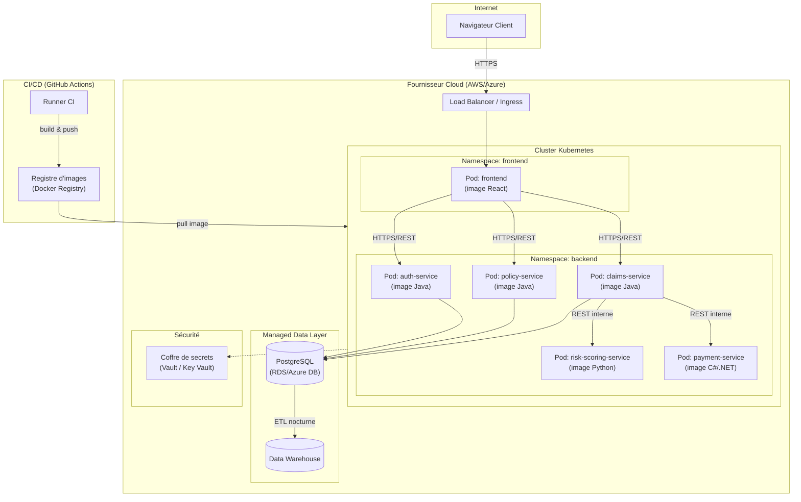

# Diagramme de déploiement (Deployment Diagram)

## À quoi ça sert ?

Le diagramme de déploiement répond à la question : **"Sur quelle machine physique/virtuelle chaque
composant logiciel s'exécute-t-il, et comment ces machines communiquent-elles ?"** C'est le seul
diagramme UML qui parle d'infrastructure plutôt que de logique métier — il fait donc le pont direct
avec le Bloc 3 du RNCP (Cloud Computing) et les livrables Terraform/Ansible de la Phase 4.

## Vocabulaire UML utilisé

- **Nœud** (`node`, boîte 3D) : une ressource physique ou virtuelle capable d'exécuter du code
  (serveur, conteneur, machine virtuelle).
- **Artefact** : l'élément logiciel concret déployé sur un nœud (ex : une image Docker, un `.jar`).
- **Lien de communication** (trait) : un canal réseau entre deux nœuds, souvent annoté du protocole.

## Le diagramme

## Lecture / justification des choix

- **Un pod Kubernetes par microservice** : traduction directe de l'architecture microservices décidée
  en `ADR-001`. Chaque pod peut être mis à l'échelle (scale) indépendamment — par exemple,
  `risk-scoring-service` peut recevoir plus de ressources CPU en cas de pic de calcul ML, sans impacter
  les autres services.
- **Séparation `frontend` / `backend` en namespaces Kubernetes distincts** : c'est une pratique de
  sécurité (isolation réseau) qui limite la surface d'attaque si le frontend est compromis.
- **`payment-service` communique en interne uniquement via `claims-service`**, jamais directement
  exposé au frontend : principe de moindre privilège — un client ne doit jamais pouvoir appeler
  directement un service de paiement.
- **Le coffre de secrets (Vault)** est isolé et référencé par pointillés (`-.secrets.->`) car ce n'est
  pas un flux de données métier mais un flux de configuration sensible — distinction volontaire pour
  anticiper le futur audit DevSecOps (Phase 3).
- **Le pipeline CI/CD est un sous-système à part**, hors du cluster de production : il construit les
  images et les pousse dans un registre, mais ne s'exécute jamais dans l'environnement de production —
  séparation classique build-time / run-time.

## Lien avec les phases suivantes

Ce diagramme sera implémenté concrètement en Phase 4 sous forme de fichiers Terraform (`infra/terraform`)
pour le provisionnement (cluster, base managée, load balancer) et Ansible (`infra/ansible`) pour la
configuration post-provisionnement. C'est le document de référence que je réutiliserai comme spec
avant d'écrire le moindre fichier `.tf`.
